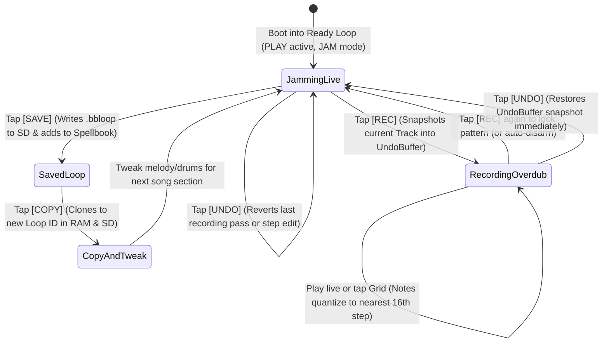
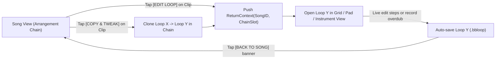

# Bard Beats: Architecture and Research Plan

Date: November 19, 2026
Status: Draft for Review
Target Platform: Nintendo 3DS Homebrew (Modded 3DS XL / Old 3DS / New 3DS)
Primary deliverables: `.3dsx` (Homebrew Launcher) first, `.cia` (installable HOME Menu title) second, built from the same source tree.

---

## 1. 3DS Homebrew Toolchain and Libraries

### 1.1 Recommended Toolchain and Core Libraries

The current standard toolchain for Nintendo 3DS homebrew is **devkitPro** with **devkitARM**, **libctru** (v2.7.x), **citro3d**, and **citro2d**.

- **Compiler and Flags**: `arm-none-eabi-g++` targeting the ARM11 MPCore (`-march=armv6k -mtune=mpcore -mfloat-abi=hard -mtp=soft`), compiled as C++17 (`-std=gnu++17 -fno-rtti -fno-exceptions -O2`). Using the hardware VFPv2 floating-point unit (`-mfloat-abi=hard`) is vital for real-time audio synthesis and pitch calculations.
- **Core System Library (`libctru`)**: Provides direct access to Horizon OS user-mode services:
  - `ndsp` (`dsp::DSP`) for 24-channel hardware-accelerated audio mixing, resampling, and filtering.
  - `mic` (`mic:u`) for recording voice takes from the built-in microphone or an attached TRRS headset microphone.
  - `hid` (`hid:USER`) for low-latency button, D-pad, Circle Pad (analog stick), and resistive touchscreen polling.
  - `fs` (`sdmc:`) and `romfs` for bundled read-only assets and SD card persistence.
- **Graphics and UI Stack (`citro2d` + `citro3d` + `tex3ds`)**:
  - **Why `citro2d` is the right pick**: Older libraries such as `sf2d`, `sftd`, and `pp2d` are deprecated and unmaintained. Higher-level desktop GUI frameworks (such as Dear ImGui or SDL2 ports) add CPU overhead and default to tiny desktop widgets that work poorly on a 320x240 resistive touchscreen.
  - `citro2d` sits directly on top of `citro3d` and uses the PICA200 GPU to render 2D primitives (`C2D_DrawRectSolid`, `C2D_DrawLine`, `C2D_DrawCircleSolid`), sprite atlases (`.t3x` built via `tex3ds` from `.t3s` scripts), and system/custom fonts (`C2D_TextBuf`, `C2D_DrawText`) with near-zero CPU cost.
  - Because Bard Beats is an **audio-first application**, keeping GPU submission under 1.5 ms per frame on Core 0 leaves the CPU completely free for immediate touch/button response and UI state transitions while the audio thread and Teak DSP handle sound generation.
  - We will write a lightweight, immediate-style touch hit-box layer on top of `citro2d` tailored for **big tap targets** (minimum 36x36 px to 48x48 px per button, 18x28 px per sequencer step cell) playable with thumbs or a stylus while a loop is running.

### 1.2 Structural Reference: Tomodachi Life Save Editor

Following the structural pattern established in `kiyoshithekidd/TomodachiLife_3DS_SaveEditior`, Bard Beats will use the same battle-tested devkitARM `3ds_rules` workflow:

- **Sprite Pipeline**: PNG icons, instrument art, and UI badges under `gfx/` are indexed in `gfx/sprites.t3s` and compiled at build time by `tex3ds` into `romfs/gfx/sprites.t3x` plus a generated C header `build/sprites.h` with named sprite indices.
- **RomFS Packaging**: Static assets (sprite sheets, instrument sample tables, default starter loops) live in `romfs/` and are automatically embedded into both `.3dsx` (`--romfs=romfs`) and `.cia` (`RomFs: RootPath: romfs` in `app.rsf`).
- **Dual Target Build**: A single `Makefile` compiles the object files into `build/`, links `BardBeats.elf`, packages `BardBeats.3dsx` by default (`make`), and builds `BardBeats.cia` via `make cia`.

### 1.3 Packaging `.3dsx` First and `.cia` Later from the Same Source

Both formats run the exact same compiled `BardBeats.elf` binary and embed the same `romfs/` directory.

1. **`.3dsx` Build (Default Target)**:
   - `bannertool makesmdh` generates `BardBeats.smdh` from `icon.png` (48x48), `APP_TITLE` ("Bard Beats"), `APP_DESCRIPTION` ("A bard's loop maker for your pocket."), and `APP_AUTHOR` ("KiyoshiTheKidd").
   - `3dsxtool` wraps `BardBeats.elf`, `BardBeats.smdh`, and `romfs/` into `BardBeats.3dsx`.
   - When launched via the Homebrew Launcher (Rosalina / `boot.3dsx`), the environment automatically grants service handles for `dsp::DSP` (including `hb:ndsp`) and `mic:u`.

2. **`.cia` Build (`make cia` Target)**:
   - `bannertool makesmdh` creates `build/icon.bin`.
   - `bannertool makebanner -i gfx/banner.png -a gfx/banner.wav -o build/banner.bnr` builds the 3D HOME Menu banner and short 2-second lute chord jingle (`banner.wav`).
   - `arm-none-eabi-strip` strips debug symbols from `BardBeats.elf` into `build/BardBeats-strip.elf`.
   - `makerom -f cia -o BardBeats.cia -elf build/BardBeats-strip.elf -rsf app.rsf -icon build/icon.bin -banner build/banner.bnr -exefslogo -target t` packages the installable CIA.

3. **Critical `app.rsf` Requirements for Audio and Mic in `.cia` Mode**:
   - Unlike a save editor, an audio and vocal recording app running as an installed HOME Menu `.cia` will fail to initialize `ndspInit()` or `micInit()` unless its ExHeader explicitly declares the audio, DSP, and microphone services and system calls in `app.rsf`:
     - **UniqueId**: `0x0F8C35` (distinct from `TomodachiLife_3DS_SaveEditor`'s `0x0F8C30` so both can coexist on the HOME Menu).
     - **ProductCode**: `CTR-P-BRDB`.
     - **ServiceAccessControl**: Must include `dsp::DSP` and `mic:u` (alongside `APT:U`, `am:u`, `cfg:u`, `fs:USER`, `gsp::Gpu`, `hid:USER`, `ndm:u`, `ptm:u`).
     - **Dependency**: Must include `dsp: 0x0004013000001a02` and `mic: 0x0004013000002002`.
     - **FileSystemAccess**: `DirectSdmc` so `sdmc:/3ds/BardBeats/` works identically in `.3dsx` and `.cia` builds.
     - **Processor / Core Access**: `IdealProcessor: 0`, `AffinityMask: 1` (or `3` to allow scheduling on Core 1 via `APT_SetAppCpuTimeLimit(30)` for background audio rendering).

---

## 2. Competitive and Comparative Research

### 2.1 On the 3DS

#### KORG M01D (Official eShop, Discontinued)
- **What it is**: An 8-track music workstation based on the Korg M1 synthesizer, featuring a 24-voice polyphonic rompler engine (over 300 presets), a 64-step piano-roll sequencer, an XY Kaoss pad for two-finger/stylus note input, and a song scene chain matrix. Saved data to the SD card with optional MIDI export.
- **What it does well**:
  - **Scene Matrix for Song Mode**: Chaining short multi-track clips ("scenes") into a song progression on a clean visual grid is effortless and stays live.
  - **Dual-Screen Split**: Keeps the song/overview context on the top screen while reserving the bottom touchscreen for direct tactile manipulation.
  - **Voice Budget Discipline**: Proves that 24 voices on the 3DS hardware is more than enough for rich multi-track arrangements when voice stealing is well tuned.
- **What is clunky or missing**:
  - **Microscopic Piano Roll**: Squeezing a multi-octave chromatic piano roll and tiny toolbar icons onto the 320x240 bottom screen requires precision stylus poking and fails the "thumb play while the loop runs" test.
  - **No Live Vocal Layer**: Strictly a MIDI rompler; no microphone recording or vocal sketching.
  - **Unavailable**: Closed with the 3DS eShop in March 2023.
- **What Bard Beats borrows**: The live scene-chaining concept for Song Mode and 24-voice polyphony management.
- **What Bard Beats avoids**: Tiny piano-roll cells, fiddly multi-page mixer menus, and encyclopedia-sized preset lists.

#### KORG DSN-12 (Official eShop, Discontinued)
- **What it is**: A 12-track monophonic analog synthesizer studio inspired by the MS-10/MS-20, with virtual patch cables, per-track 16-step up-to-64-step pattern sequencers, pattern chains, and a 3D oscilloscope/spectrum display on the top screen.
- **What it does well**:
  - **Immediate 16-Step Sequencer**: 16 steps fit cleanly across the 320px bottom screen width (20px per step), making step entry fast and readable.
  - **Visual Feedback on Top Screen**: Using the top 400x240 screen for real-time visual feedback while the bottom screen handles touch controls prevents visual clutter.
- **What is clunky or missing**:
  - **Sound Design Rabbit Hole**: Every track starts as a raw modular synth requiring oscillator, filter, and patch cable tweaking before you can play a recognizable instrument.
  - **Monophonic Tracks Only**: Strumming a lute chord requires programming three separate tracks.
- **What Bard Beats borrows**: The 16-step horizontal grid proportion across the 320px touchscreen and lively visual feedback on the top screen.
- **What Bard Beats avoids**: Exposing raw synth knobs (cutoff, resonance, ADSR, LFO routing) that slow down the Couch Bard.

#### μcor Handheld for Nintendo 3DS (Free Homebrew, Released November 12, 2026)
- **What it is**: A 3.8 MB homebrew app (`.3dsx` and `.cia`) that acts both as a Wi-Fi companion controller for the desktop/browser μcor modular workstation and as an offline pocket synth, 16-step sequencer, 8-voice drum machine, 8-slot mic sampler (`smp0.raw` and up in `sdmc:/3ds/ucor/`), effects unit, and 20-module virtual modular rack.
- **What it does well**:
  - **Transport and Undo Ergonomics**: `START` toggles play/stop globally; `REC` toggles live recording into the pattern while playing (or step entry while stopped); `UNDO / CLEAR` is always accessible to revert the last take without stopping playback.
  - **Accent by Touch Zone**: Tapping the lower half of a key or pad triggers an accented note/hit without needing a separate velocity menu.
  - **Single SD Folder Footprint**: Stores everything cleanly under `sdmc:/3ds/ucor/` so backing up is a single folder copy.
  - **Audio Priority Under Load**: Automatically drops heavy top-screen 3D rendering when DSP/CPU audio load exceeds 45% on an Old 3DS so audio never glitches.
- **What is clunky or missing**:
  - **Companion-First Identity & Page Sprawl**: Designed around 20 module pages (`Oscillator`, `LFO`, `ADSR`, `VCA`, `Ladder Filter`, etc.) and patching virtual cables to mirror the desktop μcor platform. Navigating 20 pages of synth knobs is intimidating for a casual music maker.
  - **No Song-Length Vocal Layer**: Its mic sampler records short one-shot triggers into 8 drum/key slots rather than laying down a continuous vocal melody over a clip or whole song arrangement.
  - **DSP Firmware Friction**: Requires the user to manually supply `sdmc:/3ds/dspfirm.cdc` or displays "No sound".
- **Technical Note on Source Availability**: μcor Handheld is distributed as prebuilt `.3dsx` and `.cia` binaries on `ucor.net/downloads-3ds.html`; its source code is proprietary and not publicly available. All insights above are verified from its official release documentation and hardware behavior.
- **What Bard Beats borrows**:
  - `START` for global Play/Stop, `REC` for live overdub vs. step entry, and instant single-take `UNDO`.
  - Upper/lower pad touch zone (or tap toggle) for normal vs. accented notes.
  - Self-contained SD directory (`sdmc:/3ds/BardBeats/`).
- **What Bard Beats avoids**:
  - Companion/account pairing screens, 20-page synth parameter menus, and virtual patch cords.
  - Requiring `dspfirm.cdc` if missing (Bard Beats can support standard `ndspInit()` with an automatic fallback or bundled open-source DSP component like OpenDSP so sound always works out of the box).

---

### 2.2 Off the 3DS: The First-Ten-Minutes Benchmark

We evaluated **GarageBand (iOS)**, **Koala Sampler**, **Auxy**, **Groovebox (Novation)**, **BandLab**, and **FL Studio Mobile** specifically on how fast a new user goes from launching the app to hearing a self-made loop they like.

| App | Time to First Loop | What Makes It Fast (or Slow) | Borrow for Bard Beats | Avoid in Bard Beats |
| :--- | :--- | :--- | :--- | :--- |
| **GarageBand (iOS)** | ~60 seconds | Launches straight into visual, playable Touch Instruments (smart lute/guitar strings, pads, drums) constrained to a musical scale, plus Live Loops cells that trigger quantized on the beat. | **Playable visual instruments**, scale-locked note input (no wrong notes), and one-tap **Live Loop cells** (Quick Play Spellbook). | Deep track settings, automation lanes, and multi-screen audio routing menus. |
| **Koala Sampler** | ~45 seconds | Zero modal dialog bloat. Three flat tabs (`SAMPLE`, `SEQUENCE`, `PERFORM`), chunky color-coded pads, and an always-live loop where recording quantizes or undo-reverts in one tap. | **Flat 3-mode navigation**, chunky thumb-friendly pads, and non-destructive live overdub with instant undo. | Raw sample trimming/chopping screens (Bard Beats ships ready-to-play bard instruments). |
| **Auxy** | ~45 seconds | Strips the grid down to only the notes in the chosen scale (7 or 5 rows instead of 12 chromatic rows) across 16 steps, and lets you duplicate a loop clip with one tap to tweak into the next song section. | **Scale-folded step grid** (so 8 rows fit comfortably on the 3DS screen with big cells) and **one-tap Clip Copy & Tweak**. | Subscription walls and modern EDM synth aesthetic. |
| **Groovebox (Novation)** | ~60 seconds | Pre-loads a cohesive 3-to-4 track kit (Drums, Bass, Lead, Poly) already matched in key and tempo so tracks immediately sound good together. | **Pre-paired 4-track loop layout** (Drums, Bass, Melody, Harmony/Chords) that is ready to jam on startup. | Multi-tab synth parameter editors. |
| **BandLab** | ~3 to 5 minutes | Social feed, account login, project type selector, and cloud sync stand between opening the app and playing a note. | Simple vocal overdubbing as a separate track layer over the instrumental backing. | Any setup wizard, project configuration modal, or empty "New Project" form on boot. |
| **FL Studio Mobile** | ~5 to 10 minutes | Desktop DAW crammed onto a small screen: tiny piano roll notes, channel rack routing, mixer FX chains, and file browsers. | Step sequencer drum row clarity. | Everything else: tiny hit targets, mixer racks, piano-roll zoom gestures, and DAW jargon. |

#### Key Takeaway: The "First 60 Seconds" Rule for Bard Beats
1. **Boot Straight Into a Ready Loop**: When Bard Beats opens, there is no title screen menu, no project setup modal, and no empty DAW timeline. It boots directly into Loop 1 at 110 BPM with 4 tracks pre-assigned (**Tavern Kit** on Drums, **Upright Bass** on Bass, **Bard's Lute** on Melody, **Ocarina** on Lead/Harmony).
2. **Scale-Folded Grid & Pads**: By locking the grid and pads to a musical scale (default: **Dorian** or **Minor Pentatonic**, selectable with one tap between Tavern Dorian, Minstrel Major, Dungeon Minor, and Folk Pentatonic, plus Chromatic for Chiptune Tinkerers), 8 pitch rows span a full octave+ without a single sour note, and every grid cell is tall enough to tap cleanly on a 3DS screen.

---

## 3. 3DS Audio Architecture: Synthesis, Playback, and the Sequencer Clock

### 3.1 How Sound Works on the 3DS (`ndsp` vs. `CSND` vs. `OpenDSP`)

The Nintendo 3DS has two audio hardware paths:
1. **`CSND`**: Legacy direct hardware channel service (32 channels). Deprecated by libctru, lacks proper sleep/wake handling, and conflicts with certain system states. **Do not use.**
2. **`ndsp` (Teak DSP via `dsp::DSP`)**: The official, hardware-accelerated 24-channel audio pipeline. The Teak DSP chip mixes up to **24 hardware voices** (`0..23`), performs hardware sample-rate conversion with polyphase or linear interpolation, applies per-channel biquad IIR filters and 12-float stereo/aux panning matrices, and outputs stereo PCM at **32,728.5 Hz** (`32728.498 Hz`).
   - **DSP Firmware Zero-Friction Note**: Standard `libctru` `ndspInit()` loads `/3ds/dspfirm.cdc` from the SD card or the `hb:ndsp` service provided by Luma3DS / Homebrew Launcher. On any modern Luma3DS setup (both `.3dsx` and `.cia`), `ndspInit()` succeeds automatically; for older setups missing `dspfirm.cdc`, we can either display a clear one-line prompt or link `OpenDSP` (BSD-2-Clause open-source DSP firmware replacement released November 2026) so audio works 100% of the time without user setup.

### 3.2 Streaming Mix vs. Per-Channel Voice Allocation

We have two architectural choices for driving `ndsp`:
- *Option A (Hardware Channel per Voice)*: Assign each active note to its own `ndsp` channel (`0..23`) and let the DSP resample buffers via `ndspChnSetRate()`.
- *Option B (Dedicated Software Synth + Sampler Mixer on ARM11 feeding Stereo `ndsp` Channel 0, plus Dedicated `ndsp` Channel 1 for Streaming Vocal Layer)*:
  - **Recommendation: Hybrid Architecture (Software Synth/Sample Mixer on Channel 0 + Dedicated Vocal Stream on Channel 1)**.
  - **Why this is superior for Bard Beats**:
    1. **Sample-Accurate Sequencer Timing**: When the ARM11 audio thread mixes the 4 instrumental tracks into a double-buffered stereo PCM16 stream (`ndsp` Channel 0), step boundaries occur at exact sample indices inside the audio buffer. There is **zero IPC jitter** between drum hits, bass notes, and melody chords.
    2. **Full Synth & Wavetable Expressiveness**: We can run custom Karplus-Strong plucked lute strings, NES/Game Boy pulse-width modulation, pitch-envelope drums, and smooth per-sample Circle Pad pitch-bend portamento in fast 32-bit fixed-point/float math on the ARM11 VFPv2, which raw `ndsp` one-shot buffers cannot do alone.
    3. **Vocal Layer Isolation**: `ndsp` Channel 1 is reserved exclusively for streaming the recorded Vocal Layer (`16,364.48 Hz` mono PCM16, hardware-upsampled by the Teak DSP to `32,728.5 Hz` stereo). Mute, volume, or retake of the vocal layer happens independently on Channel 1 without touching the instrumental engine on Channel 0.

### 3.3 Voice Budget and Polyphony (When Drums, Bass, Melody, and Harmony Play Together)

Our software voice pool on Channel 0 runs **16 simultaneous polyphonic voices** (easily expandable to 24, consuming less than 12% of one ARM11 core at 32,728 Hz), partitioned across the 4 loop tracks so no track ever starves another:

| Track | Role | Reserved Voices | Max Voices (with Shared Pool) | Voice Stealing Policy |
| :--- | :--- | :--- | :--- | :--- |
| **Track 1: Drums** | 4-Piece Kit (Kick, Snare/Clap, Closed Hat, Open Hat/Perc) | 4 | 4 | Same drum piece retriggers in place; Closed Hat chokes Open Hat. |
| **Track 2: Bass** | Monophonic / Legato Bassline | 2 | 2 | New note steals oldest note with a 2 ms anti-click crossfade ramp. |
| **Track 3: Melody** | Lead Instrument (Ocarina, Flute, Chiptune Lead) | 3 | 4 | Steals oldest released voice first, then oldest held voice with 2 ms crossfade. |
| **Track 4: Harmony** | Polyphonic Chords / Plucks (Lute, Harp, Hurdy-Gurdy) | 4 | 6 | Allows 3-to-4 note chords plus ring-out decay tails; steals quietest decay tail first. |
| **Vocal Layer** | Recorded Mic Audio (Clip or Song Vocal) | 1 HW (`ndsp` Ch 1) | 1 HW (`ndsp` Ch 1) | Streamed directly from RAM / SD ring buffer via `ndsp` Channel 1. |

### 3.4 Instrument Sound Engine: Hybrid Procedural Waveforms + Procedural RomFS Sample Tables

Where do the launch instrument sounds come from, and how are they generated?
- **No external copyrighted SoundFonts (`.sf2`) or ripped game samples.**
- Instead, Bard Beats uses a **Hybrid Procedural + Baked Wavetable Engine**:
  1. **Real-Time Procedural Synthesis** (for Ocarina, Chiptune Pulse, Sub Bass, Hurdy-Gurdy Drone, and Percussion Noise): Calculated live in the audio thread using band-limited wavetables (Sine, Triangle, 25%/50% Duty Pulse, Saw), ADSR envelopes, vibrato LFO, and state-variable low-pass filtering.
  2. **Pre-Synthesized Acoustic Wavetables in `romfs:/audio/`** (for Lute, Harp, Acoustic Bass, Bodhran Kick, Tavern Clap, Tambourine): Generated at build time by a deterministic Python script (`tools/gen_instruments.py`) using **Karplus-Strong physical string modeling** and modal drum synthesis, stored as compact 16-bit mono `.wav` / `.bin` tables (total size under 512 KB in RomFS).
  - This guarantees **100% original, IP-clean audio**, zero external asset dependencies, instant startup (loaded into RAM in <20 ms), and authentic acoustic pluck character alongside crisp retro synth waves.

### 3.5 The Sequencer Clock, Step Timing, and Latency Budget

#### Hardware Frame Rate of the 3DS DSP
As verified in `libctru/source/ndsp/ndsp.c`, the 3DS Teak DSP operates on a hardware sound frame interrupt every **160 samples at 32,728.498 Hz**, which is exactly **4.888 milliseconds per DSP frame** (~204.55 frames/sec).

#### Keeping Latency Low and Timing Sample-Accurate
Many beginner 3DS homebrew apps make the mistake of running `SAMPLESPERBUF = SAMPLERATE / 30` (~33 ms buffers) and polling `waveBuf.status == NDSP_WBUF_DONE` once per 60 Hz `gspWaitForVBlank()` graphic frame. That causes **35 to 50 ms of sluggish latency** and up to **16.7 ms of step-timing jitter** whenever a frame drops.

Bard Beats eliminates both problems:
1. **Dedicated High-Priority Audio Thread + `ndspSetCallback`**:
   - We register `ndspSetCallback(audioFrameCallback, &engine)` which fires inside the `ndsp` interrupt thread every **4.888 ms** (160 samples), and wakes our high-priority audio rendering thread via a `LightEvent`.
   - We use a triple-buffer of **160 samples per `ndspWaveBuf`** (or double-buffer of 320 samples = 9.77 ms).
   - **Total Live Play Input-to-Ear Latency**:
     - Touch / Button scan on main thread (runs at 60 Hz or sub-frame poll): `0 to 8 ms`
     - Lock-free command ring queue to audio thread: `< 0.1 ms`
     - Audio buffer ahead in `ndsp` queue (`2 x 160` samples): `9.78 ms`
     - **Total Worst-Case Live Latency: ~14.6 ms (Average: ~10 ms)**. In digital musical instruments, anything under 15 ms feels instantaneous to human hands.
2. **Sample-Accurate 16-Step Sequencer Clock**:
   - The sequencer clock does **not** use system wall-clock timers or VBlank counters. It counts **exact output samples** inside the audio buffer callback.
   - At sample rate $F_s = 32728.498\text{ Hz}$ and tempo $B\text{ BPM}$ (one bar of 4/4 = 4 beats = 16 sixteenth-note steps):
     $$\text{Samples per 16th-Note Step} = \frac{F_s \times 60}{B \times 4} = \frac{490927.47}{B}$$
   - We maintain a 32.32 fixed-point sample accumulator (`uint64_t stepSampleAccum`). Even while generating a single 160-sample buffer, if step $N$ transitions to step $N+1$ at sample index `73` inside that buffer, the notes for step $N+1$ trigger at **sample 73** of that buffer.
   - **Result**: Zero drift, zero jitter, rock-solid groove at any tempo from **60 BPM to 180 BPM**, regardless of what the UI or SD card is doing.

### 3.6 Live Play and Ocarina-Style Circle Pad Pitch Bend

- **Buttons for Notes**:
  - In **Instrument View** and **Pad View**, physical buttons map to an intuitive 8-note scale (one full octave in the active scale, e.g., D4 to D5, plus octave shift on `L`/`R`):
    - Inspired by the Switch/3DS Zelda ocarina model: `A`, `B`, `X`, `Y` and `D-Pad Up`, `Down`, `Left`, `Right` give immediate tactile access to 8 scale degrees without looking at your hands.
    - Simultaneously, the bottom touchscreen provides 8 large tactile pads (or instrument strings/holes) for stylus or thumb play.
- **Circle Pad for Pitch Bend**:
  - `hidCircleRead(&circlePos)` returns `dx, dy` in roughly `[-156, +156]`.
  - **Deadzone**: Radial deadzone of `|dx|, |dy| < 20` so resting a thumb does not detune the note.
  - **X-Axis (Horizontal) = Pitch Bend**:
    - Normalized $x \in [-1.0, +1.0]$ after deadzone with a smooth cubic response curve ($0.4x + 0.6x^3$) for fine control near center and full reach at the rim.
    - **Recommended Range**: **$\pm 2$ semitones** (a whole step up or down) by default, which is the universal expressive sweet spot for ocarina/lute slides and lets you reach chromatic passing tones even when the buttons are locked to a pentatonic or diatonic scale.
    - Frequency multiplier applied per audio buffer with a 5 ms one-pole smoothing filter (`pitchMult = pow2f(bendSemitones / 12.0f)` via fast LUT) so bends are silky and zipper-free.
  - **Y-Axis (Vertical) = Vibrato / Expression**:
    - Pushing Circle Pad Up ($y > 0$) adds warm 5.5 Hz pitch vibrato (up to $\pm 0.35$ semitones), letting a player hold an ocarina or lute note and shake it to life.
    - Pulling Circle Pad Down ($y < 0$) gently darkens the low-pass filter (mellowing the timbre).
  - **Recording Pitch Bend into the Grid**:
    - When recording live into the 16-step grid, each step records the quantized pitch offset (`int8_t bendCents` or semitone offset in steps of 25 cents) so expressive bends made during a live jam replay faithfully in the loop!

---

## 4. Microphone Recording and the Vocal Layer

### 4.1 3DS MIC Service Hardware Realities and Configuration

Using `libctru`'s `<3ds/services/mic.h>`:
- **Hardware Input**: Automatically routes from the built-in pinhole microphone on the 3DS housing, or switches in hardware to an external headset microphone when a 4-pole TRRS headset is plugged into the 3DS headphone jack.
- **Shared Memory Ring Buffer**:
  - `micInit(micSharedBuf, 0x30000)` requires a **`0x1000` (4 KB) page-aligned buffer** allocated via `memalign(0x1000, 0x30000)` (192 KB circular DMA window).
- **Encoding and Sample Rate**:
  - Encoding: `MICU_ENCODING_PCM16_SIGNED` (16-bit signed mono PCM).
  - Sample Rate: **`MICU_SAMPLE_RATE_16360` (`16,364.479 Hz`)**.
  - **Why `16,364.48 Hz` is the optimal rate**:
    - It is exactly half of the hardware DSP output rate (`32,728.498 Hz / 2 = 16,364.249 Hz`), making DSP polyphase upsampling completely artifact-free.
    - It captures up to ~8.1 kHz audio bandwidth (the full intelligible and melodic range of the human voice on the 3DS hardware mic) at half the RAM and SD storage footprint of 32.7 kHz:
      - **Storage rate**: `32,728 bytes/second` (~32 KB/s, or **~1.92 MB per minute** of uncompressed 16-bit mono WAV).
      - A 16-step clip vocal take at 120 BPM (2.0 seconds) is only **64 KB**.
      - A full 2-minute song vocal take is only **3.84 MB**, which easily fits in the Old 3DS's 64 MB application RAM during recording and writes to SD in under 150 ms.
- **Gain, Clamping, and Pop Prevention**:
  - On startup of a vocal take, configure `MICU_SetClamp(true)` (hardware clipping protection), `MICU_SetGain(MIC_GAIN_DEFAULT)`, and discard the first **25 ms (~410 samples)** after `MICU_StartSampling()` to suppress the hardware ADC power-on DC click, applying a 10 ms fade-in and fade-out envelope to the take.

### 4.2 How the Vocal Layer is Stored and Played Back

The vocal layer is **strictly separate from the 4-track instrumental loop**. It is never mixed or baked into the instrument buffers.

1. **Two Scopes of Vocal Takes**:
   - **Per-Clip Vocal Take (`clip_vocal`)**: Attached to a specific loop/clip slot (e.g., a 1-bar or 2-bar vocal hook, chant, or beatbox percussion layer). Its duration is locked to the exact sample length of one loop bar ($16 \times \text{SamplesPerStep} / 2$ at 16.36 kHz) so it loops seamlessly in phase with the step sequencer.
   - **Whole-Song Vocal Take (`song_vocal`)**: Attached to the Song Arrangement as a continuous linear audio stream from Bar 1 to the end of the song. This lets the Shower Singer hit record in Song Mode and sing verses and choruses straight across clip transitions.
2. **Storage Format on SD Card**:
   - Saved as standard **16-bit mono RIFF `.wav` files** (`16,364 Hz`) in `sdmc:/3ds/BardBeats/vocals/`:
     - Clip vocal: `sdmc:/3ds/BardBeats/vocals/loop_<id>_vocal.wav`
     - Song vocal: `sdmc:/3ds/BardBeats/vocals/song_<id>_vocal.wav`
   - Storing vocal takes as standard `.wav` files means they can be streamed cleanly by `ndsp` Channel 1, deleted or replaced atomically without rewriting the `.bbloop` or `.bbsong` file, and optionally played on any device if the user ever inspects their SD card.
3. **Synchronized Playback and Latency Compensation**:
   - While the user is singing, the instrumental loop plays through the 3DS headphones or speakers (`ndsp` Channel 0). Notice that live microphone pass-through monitoring to the speakers is **off by default** to prevent acoustic feedback howling between the 3DS speakers and the built-in mic right below the screen.
   - Because the DSP output buffer has ~10 ms of playback latency and the `mic:u` DMA ring buffer has ~12 ms of capture latency, a recorded vocal take is automatically **shifted earlier by a fixed 22 ms (`360` samples at 16.36 kHz) latency compensation offset** when committed. That way, when the take plays back on the next bar, the singer's voice lands dead-on the beat they heard while singing.

### 4.3 Non-Destructive Retakes: Redoing a Bad Take Without Touching the Loop

How the Shower Singer or Couch Bard redoes a vocal take at zero cost:
1. **Shadow Take Buffer in RAM**:
   - During recording, incoming samples from `micGetLastSampleOffset()` are copied into a dedicated **`vocalScratchBuf`** in application heap RAM, while any existing `vocalActiveBuf` is muted (or kept untouched on disk/RAM).
2. **One-Tap Undo / Retake**:
   - When recording finishes (either automatically at the end of the 16-step loop for a Clip Vocal, or when tapping `STOP`/`REC` in Song Mode), `vocalScratchBuf` becomes the new active vocal preview.
   - Tapping **`UNDO`** swaps the pointer back to the previous `vocalActiveBuf` immediately.
   - Tapping **`RETAKE`** (or `REC` again) restarts the vocal count-in/recording into `vocalScratchBuf`.
   - Tapping **`CLEAR VOCAL`** detaches and mutes the vocal layer while leaving all 4 instrumental tracks of the loop 100% untouched.

---

## 5. System Architecture

### 5.1 Project Directory Layout

```text
Bard-Beats/
├── .github/
│   └── workflows/
│       └── build.yml           # GitHub Actions CI building BardBeats.3dsx and BardBeats.cia
├── Makefile                    # devkitARM 3ds_rules Makefile (`make` -> .3dsx, `make cia` -> .cia)
├── app.rsf                     # CIA ExHeader config (includes dsp::DSP, mic:u, DirectSdmc)
├── icon.png                    # 48x48 application icon
├── PRD.md                      # Product Requirements Document
├── PERSONAS.md                 # Target Personas & Prioritization Rules
├── ARCHITECTURE.md             # This architecture specification
├── README.md                   # Project overview
├── tools/
│   └── gen_instruments.py      # Build-time script generating IP-clean wavetables & banner audio
├── gfx/
│   ├── sprites.t3s             # tex3ds sprite atlas manifest
│   ├── banner.png              # 256x128 CIA HOME Menu banner image
│   ├── banner.wav              # 2-second original lute chord CIA banner audio
│   ├── instruments/            # Top-screen rendered instruments (lute, ocarina, harp, drums, etc.)
│   └── ui/                     # Big tap-target buttons, step cells, spellbook tabs, icons
├── romfs/
│   ├── gfx/                    # Compiled sprites.t3x (generated at build time)
│   ├── audio/                  # Compact 16-bit PCM wavetables for Karplus-Strong lute/drums
│   └── presets/                # 4 starter loops ("Tavern Jig", "Fireball Cue", "goblin March", etc.)
├── include/
│   ├── app_state.h             # Top-level state machine, active view, transport state
│   ├── audio_engine.h          # ndsp callback, 16-voice mixer, sequencer clock, pitch bend
│   ├── synth_voices.h          # Procedural oscillators + RomFS wavetable sampler + ADSR
│   ├── mic_recorder.h          # mic:u ring buffer capture, latency compensation, shadow undo
│   ├── data_model.h            # Loop, Track, Step, Clip, Song, Section, and Vocal structs
│   ├── storage_sd.h            # Load/save .bbloop, .bbsong, and .wav files in sdmc:/3ds/BardBeats/
│   ├── ui_common.h             # Colors, fonts, big-button hit testing, persistent transport bar
│   ├── view_grid.h             # Step Sequencer Grid View (Top + Bottom screen layout)
│   ├── view_instrument.h       # Rendered Instrument View (Lute strings / Ocarina holes / Drums)
│   ├── view_pads.h             # MIDI Sound Pad View (8 large scale-locked pads + accent zones)
│   ├── view_spellbook.h        # Quick Play Saved Loops shelf ("Spellbook" one-tap cue list)
│   └── view_song.h             # Song Mode clip chain, sections, repeats, and song vocal recorder
└── source/
    ├── main.cpp                # Init (romfs, sdmc, citro2d, ndsp, mic), main 60Hz loop, clean exit
    ├── app_state.cpp           # Mode switching, undo stack, live jam -> record state transitions
    ├── audio_engine.cpp        # Real-time DSP thread, sample-accurate 16-step clock, voice stealing
    ├── synth_voices.cpp        # Instrument synthesis algorithms and drum kit generators
    ├── mic_recorder.cpp        # Microphone sampling state machine and WAV streaming on ndsp Ch 1
    ├── storage_sd.cpp          # Binary/JSON serialization and atomic SD file writes
    ├── ui_common.cpp           # Transport bar rendering, touch hit-box dispatch
    ├── view_grid.cpp           # 16-step sequencer rendering and stylus drag-painting
    ├── view_instrument.cpp     # Interactive visual instrument rendering and button/touch play
    ├── view_pads.cpp           # 4x2 MPC-style performance pad grid
    ├── view_spellbook.cpp      # Quick Play drawer for instant one-tap loop triggering
    └── view_song.cpp           # Live arrangement editor, drill-down loop edit, vocal layer UI
```

---

### 5.2 Data Model and SD Card File Format

All user files live in a single clean directory on the SD card:
```text
sdmc:/3ds/BardBeats/
├── config.bin                  # Last opened loop/song, master volume, default scale
├── loops/
│   ├── 001_Tavern_Bounce.bbloop
│   ├── 002_Fireball_Cue.bbloop
│   └── 003_Healing_Hymn.bbloop
├── songs/
│   └── 001_Ballad_of_the_Inn.bbsong
├── vocals/
│   ├── loop_001_vocal.wav      # Optional 16,364 Hz 16-bit mono WAV per loop
│   └── song_001_vocal.wav      # Optional 16,364 Hz 16-bit mono WAV for whole song
└── exports/                    # Optional standard .mid / .wav exports (see Section 6.3)
```

#### Core In-Memory & On-Disk Data Structures (`include/data_model.h`)

We use fixed-size, endian-safe binary structures with magic headers (`BBLP` for loops, `BBSG` for songs) and a version byte (`v1`) so saving or loading a loop on the SD card takes **less than 2 milliseconds** and never fragments memory.

```cpp
// Constants
constexpr int BB_NUM_TRACKS = 4;        // Drums, Bass, Melody, Harmony
constexpr int BB_STEPS_PER_LOOP = 16;   // 1 bar of 4/4 at 16th notes
constexpr int BB_MAX_POLY_PER_STEP = 4; // Up to 4 simultaneous notes/drums per step per track
constexpr int BB_MAX_SONG_CLIPS = 32;   // Up to 32 chained clip slots in a song

// Single step in one track (8 bytes)
struct StepCell {
    uint8_t notes[BB_MAX_POLY_PER_STEP]; // MIDI note numbers (0 = empty, 36..84 = active note/drum)
    uint8_t velocity;                    // 0 = off, 90 = normal, 127 = accented
    int8_t  pitchBendSemisQ4;            // Recorded Circle Pad pitch bend in 1/16th semitones (-32..+32)
    uint8_t gateLength;                  // Note length in 16th steps (1..16, default 1)
    uint8_t flags;                       // Bit 0: muted, Bit 1: tied/slide
};

// One instrumental track inside a 16-step loop (136 bytes)
struct TrackData {
    uint8_t  instrumentId;               // e.g., INST_TAVERN_KIT, INST_BASS, INST_LUTE, INST_OCARINA
    uint8_t  volume;                     // 0..100 (default 85)
    bool     muted;                      // Instant mute toggle
    uint8_t  reserved;
    StepCell steps[BB_STEPS_PER_LOOP];   // 16 steps
};

// A complete 16-step Loop (.bbloop file = 640 bytes)
struct LoopFile {
    char      magic[4];                  // "BBLP"
    uint16_t  version;                   // 1
    uint16_t  loopId;                    // Unique numeric ID (1..999)
    char      name[32];                  // User-visible name, e.g. "Fireball Cue" or "Verse A"
    uint16_t  bpm;                       // Default tempo when played standalone (60..180, default 110)
    uint8_t   scaleId;                   // SCALE_DORIAN, SCALE_MINOR_PENTA, SCALE_MAJOR, SCALE_MINOR, SCALE_CHROMATIC
    uint8_t   rootNote;                  // Root key (default D = 2)
    uint8_t   hasVocalClip;              // 1 if vocals/loop_<id>_vocal.wav exists
    uint8_t   vocalVolume;               // 0..100
    uint8_t    vocalMuted;                // 0 or 1
    uint8_t   reserved[21];              // Padding to 64-byte header
    TrackData tracks[BB_NUM_TRACKS];     // 4 tracks x 136 bytes = 544 bytes (+ 32 bytes footer/CRC)
};

// Section label for Song Mode
enum SectionTag : uint8_t {
    SEC_INTRO = 0,
    SEC_VERSE,
    SEC_CHORUS,
    SEC_BRIDGE,
    SEC_OUTRO,
    SEC_CUSTOM
};

// One entry in a Song Arrangement chain (8 bytes)
struct SongChainEntry {
    uint16_t   loopId;                   // Points by ID to a saved LoopFile (never bakes the notes!)
    uint8_t    repeatCount;              // 1..16 repeats of this 1-bar clip
    SectionTag sectionTag;               // Intro, Verse, Chorus, Bridge, Outro
    uint8_t    muteMask;                 // Optional per-clip track mute overrides (bits 0..4)
    uint8_t    reserved[3];
};

// A complete Song Arrangement (.bbsong file = 352 bytes)
struct SongFile {
    char           magic[4];             // "BBSG"
    uint16_t       version;              // 1
    uint16_t       songId;               // Unique numeric ID
    char           name[32];             // e.g. "Ballad of the Inn"
    uint16_t       bpm;                  // ONE master tempo for the whole song (60..180)
    uint8_t        numEntries;           // Number of chained clips (1..32)
    uint8_t        hasSongVocal;         // 1 if vocals/song_<id>_vocal.wav exists
    uint8_t        songVocalVolume;      // 0..100
    uint8_t        songVocalMuted;       // 0 or 1
    uint8_t        reserved[22];
    SongChainEntry chain[BB_MAX_SONG_CLIPS];
};
```

- **Why One File Per Loop (`.bbloop`) and One File Per Song (`.bbsong`)**:
  - **Live Reference Integrity**: Because `SongChainEntry` stores `loopId` pointing to `loops/<id>_<name>.bbloop`, the song is always a live arrangement pointing at loops. Editing Loop #4 immediately updates every Verse slot in the song that references Loop #4.
  - **Copy & Tweak Workflow**: When a user in Song Mode taps **`COPY & TWEAK`** on Clip 1 ("Verse A"), the app clones `001_Verse_A.bbloop` in memory to a new `loopId` (`002_Verse_B.bbloop`), points the new song slot at `002`, and opens it for editing without mutating the original clip.
  - **Atomic Crash Safety**: Each `.bbloop` is only 640 bytes. Writing to a temporary `.tmp` file and renaming on SD takes ~1.5 ms, preventing corruption if the battery dies.

---

### 5.3 Saved Loops & The "Spellbook" Quick Play List

To serve both the **Spellbook Bard** (playing a named loop on cue at the tabletop when casting a spell) and the **Couch Bard** (browsing saved loops to jam or chain):
- **Quick Play Shelf ("The Spellbook")**:
  - Accessible with **one tap** from the bottom navigation bar (`SPELLBOOK` tab or pressing `SELECT`).
  - Displays a clean 2-column grid of large cards (148x44 px each, 6 visible per page with big page arrows or D-pad Up/Down) showing the loop's name (e.g., `"Fireball"`, `"Healing Word"`, `"Tavern Jig"`), BPM badge, and vocal icon.
  - **One-Tap Cue Playback**:
    - Tapping any loop card in the Spellbook **starts playing it immediately on cue** (if stopped) or **queues it to switch seamlessly on the next beat/bar** (or immediately if "Instant Cue" toggle is active for tabletop spellcasting).
  - **Naming Loops**:
    - When saving a loop, the user can either tap **`QUICK SAVE`** (auto-names with a bardic generator like `"Ember Riff 04"`, `"Tavern Loop 05"`, or spell-style tags) so they never get interrupted while jamming, or tap **`RENAME`** to invoke the built-in 3DS system software keyboard (`swkbdInit`) to type `"Fireball"`.

---

### 5.4 Dual-Screen Layout across All Views

The 3DS has an asymmetric dual-screen setup:
- **Top Screen (400x240, non-touch)**: High-visibility stage for the playhead, full 4-track overview, visual instrument feedback, and song timeline.
- **Bottom Screen (320x240, resistive touch)**: Built strictly for **big thumb and stylus tap targets**, split into three permanent zones so the player never gets lost:

```text
+-------------------------------------------------------------------+
|                     TOP SCREEN (400 x 240)                        |
| [Loop Name: "Tavern Jig"]   [110 BPM]   [Scale: Dorian]  [Step 07]|
|-------------------------------------------------------------------|
|                                                                   |
|        CONTEXTUAL STAGE (Full 4-Track Mini-Map / Visual           |
|        Instrument Animation / Song Chain Timeline & Lyrics/Wave)  |
|                                                                   |
+-------------------------------------------------------------------+

+-------------------------------------------------------------------+
|                   BOTTOM TOUCHSCREEN (320 x 240)                  |
| [> PLAY]   [O REC (Jam)]   [<- UNDO]   [CLEAR]   [SAVE]  (y:0..36)|
|-------------------------------------------------------------------|
| [T1:Drums]   [T2:Bass]   [T3:Lute]   [T4:Ocarina]  [Mic] (y:36..68)|
|-------------------------------------------------------------------|
|                                                                   |
|                 ACTIVE WORKSPACE (y: 68..204)                     |
|    - Grid View: 16x8 scale-locked step grid (20x17px cells)       |
|    - Pad View:  4x2 large performance pads (76x64px each)         |
|    - Inst View: Touch Lute strings / Ocarina holes / Drum heads   |
|    - Song View: Chained clip cards, [+COPY], [Repeats], [EDIT]    |
|                                                                   |
|-------------------------------------------------------------------|
| [GRID]     [PADS]     [INSTRUMENT]     [SPELLBOOK]     [SONG]     |
+-------------------------------------------------------------------+
```

#### Always-Reachable Top Transport Bar (Bottom Screen `y: 0..36`)
Every button is at least **60x36 px**:
1. **`PLAY / STOP`** (also mapped to physical `START`): Starts or stops the loop/song immediately.
2. **`REC / JAM`** (also mapped to physical `R` + `A` or touch): Toggles between **JAM** (amber: live notes play over the loop without writing to the grid) and **REC** (crimson: live notes quantize and land onto the grid,with single-take undo).
3. **`UNDO`**: Reverts the last recorded overdub pass, step edit, clear, or vocal take in one tap.
4. **`SAVE / COPY`**: Saves the current loop or clones it to a new slot.

#### Track Selector Bar (Bottom Screen `y: 36..68`)
- Four wide buttons (`Drums`, `Bass`, `Melody`, `Harmony`) plus a `Vocal` badge:
  - **Tap** to select which track you are playing/editing.
  - **Tap the speaker icon** on the corner of a track tab (or hold `L` + tap) to mute/unmute that track live.
  - Tapping the active track tab a second time cycles its instrument preset (e.g., `Lute` -> `Harp` -> `Hurdy-Gurdy` -> `Square Wave`).

#### View-by-View Breakdown

1. **Grid View**:
   - **Top Screen (400x240)**: Shows all 4 tracks stacked vertically as a master 16-step overview with a bright sweeping playhead bar, current instrument name, scale/BPM readout, and a pulse meter.
   - **Bottom Screen Workspace (320x136)**: Displays the **active track's 16-step x 8-row grid**. Each step cell is **20 px wide x 17 px tall**: wide enough for a stylus tip or thumb tap, with 4-beat bar lines every 4 steps (`1..4 | 5..8 | 9..12 | 13..16`). Dragging the stylus across cells paints or erases a melody in one motion.

2. **Rendered Instrument View**:
   - **Top Screen (400x240)**: Displays a large, richly illustrated fantasy instrument (the **Bard's Lute** fretboard, **Ocarina** body with glowing finger holes and Circle Pad pitch-bend gauge, **Tavern Drum Kit**, or **Minstrel Harp**) that animates every string pluck, finger hole, and pitch bend in real time, alongside a compact 16-step beat progress bar at the top.
   - **Bottom Screen Workspace (320x136)**: Displays a tactile playable surface matched to the instrument (e.g., 8 pluckable lute strings/frets or 8 ocarina tone holes) while physical buttons (`A, B, X, Y, D-Pad`) and the Circle Pad play notes and bend pitch simultaneously.

3. **MIDI Sound Pad View**:
   - **Top Screen (400x240)**: Same 4-track 16-step loop overview + live pitch bend / active chord visualizer so you can watch your notes land on the grid as you jam.
   - **Bottom Screen Workspace (320x136)**: A **4x2 grid of 8 huge performance pads (76x64 px each)**. For Drums, pads trigger Kick, Snare, Clap, Closed Hat, Open Hat, Tom, Tambourine, and Roll. For melodic tracks, the 8 pads play a full scale octave (`Root` through `Octave`). Tapping the lower half of a pad triggers an accented hit (`velocity = 127`).

4. **Song Mode View**:
   - **Top Screen (400x240)**: Shows the horizontal **Song Arrangement Timeline** (Intro -> Verse -> Chorus -> Outro), total bars, master song BPM, currently playing clip and repeat counter (`Bar 2 of 4`), and the **Vocal Layer Waveform Ribbon** underneath the timeline.
   - **Bottom Screen Workspace (320x136)**: Shows the scrollable chain of Clip Cards with big **`+ ADD`**, **`COPY & TWEAK`**, **`REPEAT -/+`**, **`SECTION TAG`**, **`EDIT LOOP`**, and **`REC VOCAL (CLIP / SONG)`** buttons.

---

### 5.5 State Flow for a Loop (Jam -> Record -> Undo -> Save -> Copy & Tweak)



1. **Zero-Commitment Jamming**: By default, when the loop is running (`PLAY`), the transport is in **JAM** state. The Couch Bard can mash buttons, strum lute strings, and bend the Circle Pad alongside the beat for as long as they want without dirtying the grid.
2. **Snapshotted Record Pass**: The moment the player taps **`REC`**, the engine copies the current track's 16 `StepCell`s (`136 bytes`) into `undoTrackSnapshot`. Every note played live is quantized to the nearest 16th-note step (`round(sampleOffset / samplesPerStep) % 16`) along with its Circle Pad pitch bend and velocity.
3. **Instant Undo**: If a pass felt off, tapping **`UNDO`** copies `undoTrackSnapshot` back into the active track on the very next 4.88 ms audio frame while the loop keeps playing without missing a beat.

---

### 5.6 State Flow for a Song and Editing Loops from Song View



1. **Chaining Clips**: In Song View, the player chains saved loops into slots (`Slot 1: Loop 01 [Intro] x2`, `Slot 2: Loop 02 [Verse] x4`, `Slot 3: Loop 03 [Chorus] x4`), sets one master BPM for the whole song, and hits `PLAY`.
2. **Copy & Tweak in One Tap**: Tapping **`COPY & TWEAK`** on any clip slot duplicates the underlying `.bbloop` to a new loop ID (e.g., `"Verse A"` -> `"Verse A (Var)"`), inserts it as the next slot in the song, and opens it for editing.
3. **Drill-Down Editing from Song View ("The Song Never Freezes")**:
   - Tapping **`EDIT LOOP`** on any clip slot in Song View pushes a lightweight `SongReturnContext { songId, chainIndex }` onto the navigation stack and switches to Grid/Pad/Instrument View with that loop loaded (playing at the song's master BPM).
   - A prominent **`< BACK TO SONG`** badge appears in the top bar. Any edits made to that loop save directly to its `.bbloop` file. Tapping `< BACK TO SONG` returns immediately to Song View at the exact same clip slot, with the edited loop already live in the arrangement.

---

## 6. Answers and Recommendations for the Three PRD Open Decisions

### Decision 1: Tracks per Loop
- **Question**: How many tracks does one loop have? Drums, bass, and melody, plus a fourth?
- **Recommendation**: **4 Instrumental Tracks per Loop (`Drums`, `Bass`, `Melody`, `Harmony/Chords`), plus the separate non-baked Vocal Layer.**
- **Reasoning**:
  1. **Musical Completeness for a Bard**: A 3-track loop (Drums, Bass, Melody) forces the player to choose between strumming lute chords *or* playing an ocarina lead melody. Having a 4th track (`Harmony/Chords`) lets the player lay down a tavern drum beat (Track 1), a walking bassline (Track 2), strummed lute chords (Track 3/4), and a soaring pitch-bent ocarina melody (Track 3/4) on top.
  2. **UI Ergonomics on 320x240**: 4 track selector buttons fit horizontally across the 320px bottom screen (`4 x 68 px` + `48 px` Vocal badge) with large, unmissable tap targets and zero horizontal scrolling.
  3. **Hardware Headroom**: 4 tracks with up to 16 total polyphonic voices consume under 12% of Core 0 CPU time, leaving massive headroom for 60 FPS `citro2d` rendering and `mic:u` vocal streaming.

### Decision 2: Instruments at Launch (v1 Roster)
- **Question**: Which instruments ship in v1?
- **Recommendation**: **8 Curated Instruments (2 per Track Role)** chosen for distinct sonic character, bard flavor, and chiptune appeal:

| Track Role | Default Launch Instrument | Alternate Launch Instrument | Synthesis / Sound Technique |
| :--- | :--- | :--- | :--- |
| **1. Drums** | **Tavern Kit** (Bodhran frame kick, woodblock/handclap snare, tambourine jingle hat, shaker) | **8-Bit Dungeon Kit** (Pitch-swept triangle kick, LFSR noise snare, crispy chip hi-hats) | Pre-baked modal percussion + procedural noise/pitch envelopes |
| **2. Bass** | **Tavern Upright Bass** (Warm acoustic plucked double bass) | **Dungeon Sub Bass** (Fat resonant triangle/saw synth bass) | Karplus-Strong low string table + filtered triangle oscillator |
| **3. Melody** | **Ocarina** (Sweet, breathy vessel flute made for Circle Pad pitch bends and vibrato) | **Chiptune Pulse Lead** (Classic 25%/50% duty pulse wave with subtle pitch glide) | Pure band-limited sine/triangle + breath harmonic & duty-cycle pulse |
| **4. Harmony** | **Bard's Lute** (Bright plucked gut-string lute for arpeggios and chords) | **Minstrel Harp & Hurdy-Gurdy** (Plucked Celtic harp / droning bowed wheel string) | Karplus-Strong plucked string wavetable + saw/drone filter |

- **Reasoning**:
  - Serves every persona in `PERSONAS.md`: The **Couch Bard** and **Spellbook Bard** get the iconic Lute, Ocarina, Harp, and Tavern Kit right away; the **Chiptune Tinkerer** can flip each track to its retro chip counterpart (8-Bit Kit, Sub Bass, Pulse Lead) with one tap; and the **New Music Maker** is never paralyzed by a 300-preset dropdown menu.

### Decision 3: Save and Export Format
- **Question**: Loops and songs save as app files on the SD card. MIDI export, audio export, or neither?
- **Recommendation**:
  - **Primary Native Persistence**: Native `.bbloop` (640-byte loop file), `.bbsong` (352-byte song arrangement file), and standard `.wav` (`16,364 Hz` 16-bit mono PCM) for vocal layers under `sdmc:/3ds/BardBeats/`.
  - **Export in v1**: **Include lightweight Standard MIDI (`.mid`) Export in Slice 1 and Combined WAV (`.wav`) Audio Render Export in Slice 2, but keep both strictly optional behind a single `[EXPORT TO SD]` button in the Save drawer.**
- **Reasoning**:
  1. **Vocal Takes Are Already Standard WAVs**: Because vocal layers are stored as standard RIFF `.wav` files in `sdmc:/3ds/BardBeats/vocals/`, they are already readable by any device without any conversion tool.
  2. **Standard MIDI File (`.mid`) Export is ~80 Lines of C++**: A Format-1 Standard MIDI file writing 4 tracks of 16th-note `NoteOn`/`NoteOff` and `PitchWheel` events is tiny, requires zero external libraries, runs in `< 5 ms`, and gives the Chiptune Tinkerer or Couch Bard an easy way to pull a favourite melody off the SD card later without complicating the app.
  3. **Offline WAV Bounce of a Loop/Song Uses the Existing Mixer**: Because our audio engine mixes all 4 tracks in software on the ARM11, rendering a loop or song + vocal layer to `sdmc:/3ds/BardBeats/exports/<name>.wav` just calls the existing `mixAudioBuffer()` function in a fast non-realtime loop (~0.5 seconds to bounce a full song to SD).
  4. **Never Blocks the Core Workflow**: Regular `SAVE` writes `.bbloop` / `.bbsong` in `< 2 ms` so the Couch Bard never waits on an export progress bar.

---

## 7. Phased Build Plan

### 7.1 Slice 1: Step Sequencer Grid + Live Play + Loop Save (The Priority)

Slice 1 delivers a complete, playable loop maker on real 3DS hardware. The player can pick instruments, switch between the Grid, Pads, and Rendered Instrument views, jam live with buttons and Circle Pad pitch bend, record patterns onto the 16-step grid, undo bad takes, save named loops to the SD card, and trigger them with one tap from the Spellbook Quick Play shelf.

#### Files and Components Touched in Slice 1
- **Build & Packaging**:
  - `Makefile`, `app.rsf`, `icon.png`, `tools/gen_instruments.py`, `.github/workflows/build.yml`
  - `gfx/sprites.t3s`, `gfx/ui/*`, `gfx/instruments/*`, `romfs/audio/*`, `romfs/presets/*`
- **Core Audio & Sequencer Engine**:
  - `include/audio_engine.h`, `source/audio_engine.cpp` (`ndsp` init, 160-sample frame callback, 16-voice mixer, sample-accurate 16-step clock, Circle Pad pitch bend smoothing)
  - `include/synth_voices.h`, `source/synth_voices.cpp` (8 launch instruments: Tavern Kit, 8-Bit Kit, Upright Bass, Sub Bass, Ocarina, Pulse Lead, Bard's Lute, Minstrel Harp)
- **Data Model & SD Persistence**:
  - `include/data_model.h` (`StepCell`, `TrackData`, `LoopFile`)
  - `include/storage_sd.h`, `source/storage_sd.cpp` (`sdmc:/3ds/BardBeats/loops/*.bbloop` load/save, starter preset seeding, optional `.mid` export)
- **Views & State Machine**:
  - `include/app_state.h`, `source/app_state.cpp` (Play/Stop, Jam vs. Record overdub, single-take Undo snapshot, Copy Loop)
  - `include/ui_common.h`, `source/ui_common.cpp` (Top transport bar, 4-track selector, scale/tempo steppers)
  - `include/view_grid.h`, `source/view_grid.cpp` (16x8 scale-locked touch grid + top-screen 4-track overview)
  - `include/view_pads.h`, `source/view_pads.cpp` (4x2 chunky performance pads with lower-half accent zone)
  - `include/view_instrument.h`, `source/view_instrument.cpp` (Rendered Lute, Ocarina, Harp, and Drums with live animation)
  - `include/view_spellbook.h`, `source/view_spellbook.cpp` (Named loops shelf with one-tap cue playback and `swkbd` rename)
  - `source/main.cpp`

#### Definition of "Done" for Slice 1
1. Compiles cleanly with zero warnings under `devkitpro/devkitarm` into both `BardBeats.3dsx` and `BardBeats.cia`.
2. Boots directly into an active 4-track loop ready to play in under 1.5 seconds.
3. All 8 launch instruments play with zero crackles, clicks, or voice starvation when all 4 tracks trigger on the same step.
4. Both note entry methods work seamlessly while the loop is running: tapping/dragging cells on the 16-step Grid, and playing live on buttons/touchscreen in Instrument or Pad View with Circle Pad pitch bend.
5. `REC` captures live play quantized to the 16-step grid, and `UNDO` immediately reverts the last recording pass or edit while playback continues.
6. Saving, renaming, copying, and one-tap triggering of named loops in the Spellbook persist reliably across app restarts on `sdmc:/3ds/BardBeats/loops/`.

#### Slice 1 Real-Hardware Playtest Checklist (Modded 3DS XL)
- [ ] **First-60-Seconds Couch Bard Test**: Launch `BardBeats.3dsx` from Homebrew Launcher. Without reading any prompt, tap `PLAY`, tap cells on the grid, switch to Ocarina, jam live with `A/B/X/Y`, hit `REC`, play a melody, and confirm it loops back on the next bar.
- [ ] **Latency & Circle Pad Feel Test**: In Instrument View with Ocarina selected, tap `A/B/X/Y` rapidly while sweeping the Circle Pad left/right ($\pm 2$ semitones) and up (vibrato). Verify that note onset feels instant (<15 ms) and pitch bends are smooth with no stepping noise.
- [ ] **No-Commitment Undo Test**: With a good 4-track loop playing, hit `REC`, intentionally mash random notes across the bar, then tap `UNDO` while the loop is still playing. Confirm the track reverts cleanly on the next audio frame without pausing the beat.
- [ ] **Thumb & Stylus Ergonomics Test**: Operate the transport bar (`PLAY`, `REC`, `UNDO`, `SAVE`), track tabs, and 16-step grid cells using both a stylus and bare thumbs while holding the 3DS XL comfortably. Confirm no accidental neighboring-button misfires.
- [ ] **Spellbook Cue Test**: Save three named loops (`"Fireball"`, `"Healing Hymn"`, `"Tavern Bounce"`). Open the Spellbook view and tap each card in turn. Confirm one-tap playback starts on cue and survives quitting and relaunching the app.
- [ ] **Shell Close / Sleep Mode Test**: Close the 3DS XL clamshell while a loop is playing, wait 5 seconds, and open it. Confirm `ndsp` suspends cleanly on sleep and resumes playback without crashing or hanging.

---

### 7.2 Slice 2: Song Mode and the Vocal Layer

Slice 2 turns saved loops into full multi-section songs and adds one-tap microphone vocal sketching per clip and across the whole song, while keeping the entire arrangement live and editable.

#### Files and Components Touched in Slice 2
- **Microphone Capture & Vocal Streaming**:
  - `include/mic_recorder.h`, `source/mic_recorder.cpp` (`micInit` 192 KB 4KB-aligned shared memory, `16,364 Hz` PCM16 capture, 22 ms latency compensation shift, shadow take buffer for non-destructive retakes, RIFF `.wav` writer/reader)
  - `include/audio_engine.h`, `source/audio_engine.cpp` (Enable `ndsp` Channel 1 vocal stream synchronized to sequencer bar/song sample counter)
- **Song Arrangement Data Model & Storage**:
  - `include/data_model.h` (`SongChainEntry`, `SongFile`, `SectionTag`)
  - `include/storage_sd.h`, `source/storage_sd.cpp` (`sdmc:/3ds/BardBeats/songs/*.bbsong` and `sdmc:/3ds/BardBeats/vocals/*.wav` persistence, plus optional offline song `.wav` mixdown export)
- **Song Mode UI & Drill-Down Loop Editing**:
  - `include/view_song.h`, `source/view_song.cpp` (Top-screen Song Timeline + Vocal Waveform Ribbon; Bottom-screen Clip Chain cards, Repeat count steppers, Section tags, `COPY & TWEAK`, `EDIT LOOP` drill-down, and `REC VOCAL` controls)
  - `include/app_state.h`, `source/app_state.cpp` (`SongReturnContext` stack so jumping from Song View into a loop and tapping `< BACK TO SONG` preserves song playback position and state)
- **`.cia` Polish & Release Packaging**:
  - `gfx/banner.png`, `gfx/banner.wav`, `Makefile` (`make cia` target verification on hardware HOME Menu)

#### Definition of "Done" for Slice 2
1. Players can chain up to 32 clip slots in Song View, assign section labels (`Intro`, `Verse`, `Chorus`, `Bridge`, `Outro`) and repeat counts (`1x..16x`), and set one master BPM for the entire song.
2. **`COPY & TWEAK`** duplicates any clip in the song chain to a new `.bbloop` ID and opens it for immediate variation editing.
3. **`EDIT LOOP`** opens any clip from Song View in Grid/Pad/Instrument View, and changes immediately reflect in the live song arrangement without re-rendering.
4. One-tap **Vocal Recording** works both **per clip** (looping 1-bar vocal layer) and **over the whole song** (continuous vocal stream from start to finish), using either the built-in 3DS mic or a plugged-in TRRS headset mic.
5. **Non-destructive vocal retakes**: Tapping `UNDO`, `RETAKE`, or `CLEAR VOCAL` replaces or removes the vocal `.wav` layer without altering a single note of the 4 instrumental tracks underneath.
6. Both `.3dsx` and `.cia` builds pass full hardware verification on a modded 3DS XL, including `dsp::DSP` and `mic:u` permissions when launched from the HOME Menu as an installed `.cia`.

#### Slice 2 Real-Hardware Playtest Checklist (Modded 3DS XL)
- [ ] **Copy-and-Tweak Song Build Test**: Start with one 16-step loop (`"Verse A"`). Enter Song View, tap `COPY & TWEAK` twice to create `"Verse B"` and `"Chorus"`, tweak their melodies, set repeat counts (`2x`, `2x`, `4x`), and play the song start to finish. Confirm smooth, gapless transitions at every bar boundary and unified master tempo.
- [ ] **Live Drill-Down Edit Test**: From Song View, tap `EDIT LOOP` on the Chorus clip, add an Ocarina harmony line, and tap `< BACK TO SONG`. Play the song and confirm the updated Chorus plays live in the arrangement.
- [ ] **Per-Clip Vocal Sketch Test**: On a 1-bar loop, tap `REC VOCAL (CLIP)`, hum or beatbox a 1-bar riff into the built-in 3DS mic, and let it loop into playback on the next bar. Confirm the vocal lands on beat (22 ms latency compensation verified) and sounds clean without startup pops.
- [ ] **Whole-Song Vocal & Headset Mic Test**: Plug a TRRS headset with mic into the 3DS XL headphone jack. In Song View, tap `REC VOCAL (SONG)` and sing across multiple chained clips (`Intro -> Verse -> Chorus`). Play back from start to finish and verify vocal sync across the entire arrangement.
- [ ] **Bad Take Redo Test**: Record an intentionally terrible vocal take over a favorite loop. Tap `UNDO` (or `RETAKE`) and confirm the previous vocal take is restored (or overwritten) while all 4 instrumental tracks underneath remain untouched.
- [ ] **HOME Menu `.cia` Installation Test**: Install `BardBeats.cia` via FBI on the modded 3DS XL, launch it from the HOME Menu (verifying the 3D banner and lute jingle), and verify that `ndsp` audio, `mic:u` vocal recording, and `sdmc:/3ds/BardBeats/` saves work identically to the `.3dsx` build.
